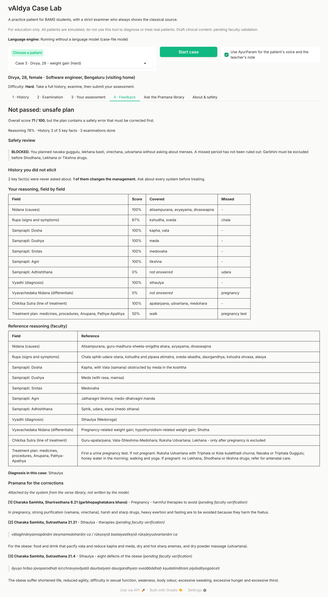

# vAIdya Case Lab

**A practice patient for BAMS students, with a strict examiner who always shows the classical source.**

Built on [AyurParam](https://huggingface.co/bharatgenai/AyurParam), IIT Bombay's open Ayurveda language model, for
*AyushTech Innovate: National Open Ayurveda AI Challenge* (Techfest, IIT Bombay, with the Ministry of Ayush and AIIA).

- **Live app:** https://huggingface.co/spaces/pkakunje/vaidya-case-lab
- **Code:** https://github.com/prasannakakunje/vaidya-case-lab
- **Team vAIdya** (TM-6C60B98017B): Dr. Prasanna K.G., PhD scholar (Ayurveda), RGUHS; Professor & HoD,
  Dept. of Kayachikitsa, Prasanna College of Ayurveda & Hospital, Belthangady

> For education only. All patients are simulated. Do not use this tool to diagnose or treat real patients.
> Cases and verses reviewed and approved by Dr. Prasanna K.G. (Kayachikitsa) on 26 Nov 2026.



## What it does

1. **Take the history.** The student questions a virtual patient (the *Rogi agent*) in plain language. The patient
   answers only what is asked. Some facts are *hidden*: they come out only if the student asks the right question,
   such as a missed period in an obesity case or black stools in an acidity case.
2. **Examine.** Ashtavidha and Dashavidha findings are released from the case file on request.
3. **Submit the reasoning.** Nidana, Purvarupa, Rupa, Upashaya, Samprapti (dosha, dushya, srotas, agni, adhishthana),
   Vyadhi, Vyavachedaka Nidana, Chikitsa Sutra and the treatment plan.
4. **Get examined.** The *Pariksha agent* grades each field against the faculty reference, the safety rules check
   the plan, and the *Pramana agent* attaches the verse behind every correction.
5. **Ask the library.** Any question about a concept gets the matching verses, or an honest "no Pramana found".
6. **See why Pramana matters.** The same question goes to plain AyurParam and to vAIdya side by side, so the
   difference between an unsourced answer and a verse-grounded one is visible.

## How it stays safe

| Layer | What it does | Uses the language model? |
| --- | --- | --- |
| Case file | Patient facts and examination findings are written by faculty, never generated | No |
| Patient-reply check | A reply that names a disease or dosha, or states a number not in the case file, is discarded and the case-file text is used | Checks the model |
| Pramana library | Citations are attached by code from a verse library with full references | No |
| Abstention | If no verse covers the question, the answer is "no Pramana found" | No |
| Support check | A model answer whose words are not supported by the retrieved verses is withheld | Checks the model |
| Contraindication rules | Block unsafe plans: Garbhini not excluded, Snehana in sama avastha, stopping prescribed modern medicine, alarm features not screened or not referred, Visha dravyas without Shodhana and dose | No |

## Architecture

```
Student (web app)
   │
Safety and verification layer ── contraindication rules · citation binding · abstention · reply checks
   │
Orchestrator (app.py)
   │
AyurParam 2.9B ── one engine, three roles
   ├── Rogi agent (patient)      ← faculty case bank       (vaidya/data/cases.json)
   ├── Pariksha agent (examiner) ← reference reasoning + rubric
   └── Pramana agent (explainer) ← Pramana verse library   (vaidya/data/verses.json)
```

AyurParam runs in one of three ways (`VAIDYA_BACKEND`):

| Backend | Where | Model |
| --- | --- | --- |
| `zerogpu` | Hugging Face Space on ZeroGPU (the hosted demo) | `bharatgenai/AyurParam`, bf16; the GPU is attached only while a reply is generated |
| `llamacpp` | Hugging Face Space on CPU, college lab PCs, offline | 4-bit GGUF build of AyurParam (`A-Aryam/AyurParam-GGUF`, about 1.7 GB) |
| `transformers` | Google Colab T4 GPU (see `notebooks/run_on_colab.ipynb`) | `bharatgenai/AyurParam`, fp16 |
| `none` | Anywhere | No model: patient replies and feedback come straight from the case file |

`auto` (default) picks ZeroGPU on a ZeroGPU Space, then a local GPU, then the 4-bit CPU build, then case-file mode.
If GPU time runs out, replies fall back to the case-file text, so the app never stops working. Prompts use AyurParam's
own format, `<context> … <user> … <assistant>`.

## Evaluation (team test set, v1)

Run `python -m eval.run_eval`. Results on 26 Nov 2026:

| Measure | Result |
| --- | --- |
| Retrieval: correct verse in top 3 (34 questions) | 100% |
| Retrieval: correct verse ranked first | 94% |
| Correct abstention on out-of-library questions (12) | 100% |
| Unsafe plans blocked (13 seeded) | 100% |
| Safe plans wrongly blocked (5) | 0 |
| Leaky patient replies rejected (5) | 100% |
| Retrieval time per question | under 1 ms |

These numbers come from a small test set written by the team, on a 25-verse library. They show that the
mechanisms work as designed; they are not an independent clinical validation. A larger, blinded test set and review
by other Kayachikitsa faculty are the next steps.

## Run it yourself

```bash
pip install -r requirements-dev.txt
VAIDYA_BACKEND=none python app.py          # case-file mode, no model download
pytest -q                                   # 29 tests
python -m eval.run_eval
```

With AyurParam on CPU: `pip install -r requirements.txt && python app.py`.
On a GPU: open `notebooks/run_on_colab.ipynb` in Google Colab.

## Project structure

```
app.py                  Gradio interface
vaidya/agents.py        Rogi, Pariksha and Pramana agents; reply and support checks
vaidya/cases.py         Case bank and question-to-fact matching
vaidya/retrieval.py     Pramana library, BM25 retrieval with abstention
vaidya/rules.py         Contraindication rules engine
vaidya/llm.py           AyurParam backends (llama.cpp, transformers, none)
vaidya/text.py          Sanskrit spelling normalisation and fuzzy matching
vaidya/data/            cases.json, verses.json
eval/                   Test questions and evaluation script
tests/                  Unit tests
notebooks/              Colab notebook for GPU runs
```

## Data and licences

- **Code:** Apache 2.0 (see `LICENSE`).
- **Cases:** synthetic, written by the team; no real patient data.
- **Verses:** typed from standard editions of Charaka Samhita, Sushruta Samhita, Ashtanga Hridaya, Madhava Nidana
  and Chakradatta, and reviewed by Dr. Prasanna K.G. on 26 Nov 2026. Verse numbering differs between editions.
  Nine entries are meaning-only for now; their verse text is to be added. Safety guidelines that are not classical are labelled as such.
- **Model:** AyurParam by BharatGen (IIT Bombay); 4-bit GGUF conversion by A-Aryam on Hugging Face. Weights are
  downloaded at run time under their own licences and are not part of this repository.

## Adding a case

Add an entry to `vaidya/data/cases.json`: patient profile, opening words, facts (each with topics, and `hidden`
for facts the patient never volunteers), examination findings, and the reference reasoning with the concepts the
grader looks for. Run `pytest` to check the links to the verse library.
